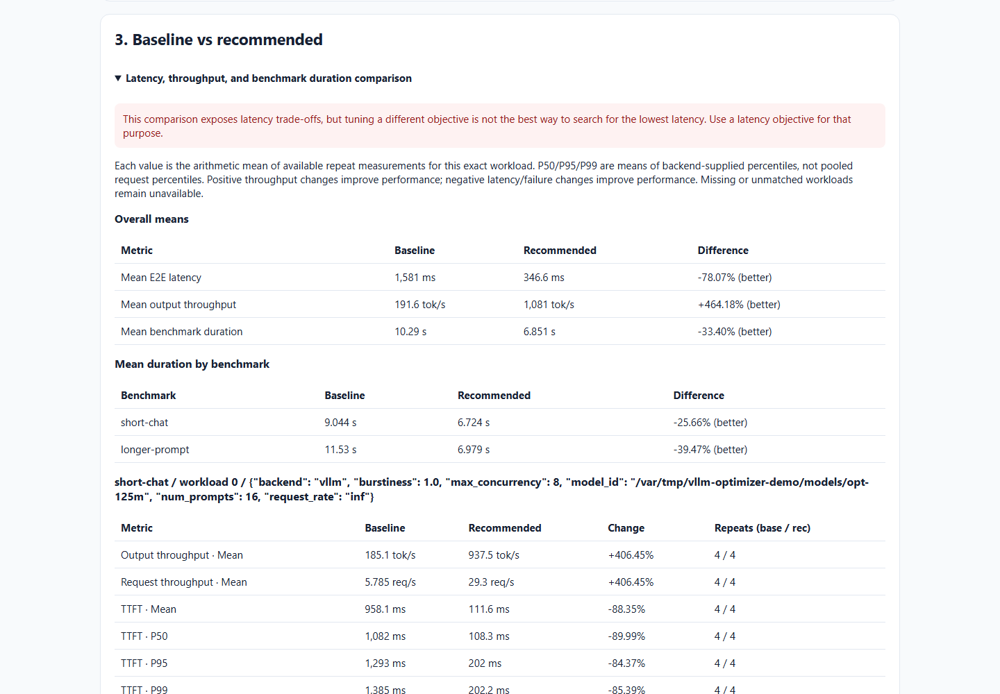

# vLLM Optimizer

Find better vLLM serving settings for your workload. Define a search space in
YAML; `vllm-opt` runs the benchmarks and reports the best observed settings.

**[Run your first experiment](https://brtydse100.github.io/vllm-optimizer/getting-started/)** ·
**[Documentation](https://brtydse100.github.io/vllm-optimizer/)** ·
**[PyPI](https://pypi.org/project/vllm-optimizer/)**

This is independent community alpha software, not affiliated with vLLM.
Execution needs Python 3.11–3.12, Linux/WSL, an NVIDIA GPU, and a local model.
Native Linux, L40/H100, tensor-parallel, and multi-GPU evidence remain
**hardware validation pending**. See the [compatibility matrix](docs/reference/compatibility.md).

## Install

| Use | Command |
| --- | --- |
| Run GPU experiments on Linux/WSL | `pip install "vllm-optimizer[runtime]"` |
| Inspect configs and saved results on any supported OS | `pip install vllm-optimizer` |

Use a virtual environment. The runtime extra installs vLLM and GuideLLM;
the core package requires an existing runtime to execute experiments.
See [installation choices](docs/getting-started/installation.md) for setup and
existing CUDA environments.

## First experiment

The [quick start](docs/getting-started/index.md) contains one complete example:

1. Install the runtime in a virtual environment.
2. Copy the YAML and set your local model path. Models are not downloaded.
3. Validate and run it; open the printed `report.html` path.

Read the walkthrough in 5–10 minutes. Installation and benchmark time depend
on your machine and model.

## What you can tune

- Fixed or tunable vLLM flags and environment variables.
- Grid, Random, or TPE search with a baseline comparison.
- GuideLLM or native vLLM Bench Serve workloads.
- Throughput objectives subject to latency/throughput targets, such as
  p99 TTFT ≤ `"200 ms"` or request throughput ≥ `"50 req/s"`.

Search keeps its configured budget after meeting a target. Only configurations
satisfying every limit can win. See [search and scoring](docs/guides/search-and-scoring.md).

## See a real report

[Open the interactive RTX 3080 report](https://brtydse100.github.io/vllm-optimizer/results/rtx3080/report-showcase/report.html)
· [Experiment YAML](docs/results/rtx3080/report-showcase/experiment.yaml)
· [Baseline-control example](https://brtydse100.github.io/vllm-optimizer/results/rtx3080/baseline-control/report.html)

This deliberately small workload measured 194.34 → 1,082.27 output tokens/s.
It demonstrates reporting and latency trade-offs; it is not a production
benchmark or an expected improvement for other workloads. The published example
used vLLM 0.28.0 and GuideLLM 0.7.3; dated runtime details and required WSL flags
are in [compatibility](docs/reference/compatibility.md).

## Next steps

| Task | Guide |
| --- | --- |
| Set fixed values and search ranges | [Configuration](docs/guides/configuration.md) |
| Choose workloads and datasets | [Benchmarking](docs/guides/benchmarks/benchmarking.md) |
| Use native vLLM benchmarking | [vLLM Bench Serve example](docs/reference/yaml/full-example-vllm-bench.md) |
| Understand confidence and target eligibility | [Reports](docs/guides/reports.md) |
| Retry, reproduce, or regenerate results | [CLI reference](docs/reference/cli.md) |
| Run independent trials on separate GPUs | [Parallel trials](docs/guides/parallel-trials.md) |
| Resolve runtime failures | [Troubleshooting](docs/guides/troubleshooting.md) |
| Find every YAML section | [Complete YAML](docs/reference/yaml/full-example.md) |

Use `vllm-opt --config experiment.yaml --verbose` to stream logs. Full trial
logs are saved regardless of verbosity; `NO_COLOR` disables terminal colors.

Install `vllm-optimizer`, import `vllm_optimizer`, and run `vllm-opt`.
The former `vtune` aliases are deprecated; see [migration](docs/guides/migration-vllm-optimizer.md).

## Contribute

[Contributing](CONTRIBUTING.md) · [Architecture](docs/project/ARCHITECTURE.md) ·
[Roadmap](docs/project/roadmap/ROADMAP.md) · [Release notes](CHANGELOG.md)
